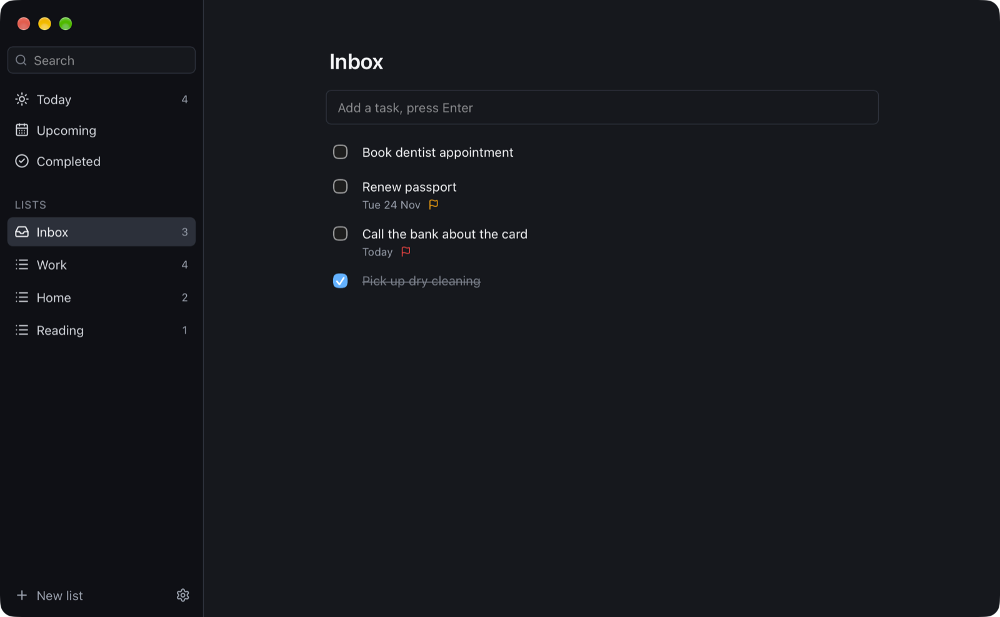

# Elyro

An offline todo app for macOS. No accounts, no network, no sync: everything lives in one local SQLite file.



## Features

- **Lists**: a built-in Inbox plus your own lists; drag to reorder, drag a task onto a list to move it.
- **Tasks**: due date, priority, notes; complete, reorder, move between lists.
- **Smart views**: Today (due today or overdue), Upcoming, Completed, and search.
- **Keyboard first**: ⌘N new task, ⇧⌘N new list, ⌘F search, ↑/↓ select, Space complete, ⌘⌫ delete.
- **Runs in the background**: a ✓ menu bar icon with Quick Add, Today and your chosen lists (with counts),
  ⌥⌘N quick add from any app, optional Launch at Login, and an option to hide the Dock icon.
- **Data safety**: automatic daily backup (last 7 kept), JSON export and import.
- Follows light and dark mode and remembers the window size and position.

Data is stored in `~/Library/Application Support/Elyro/` (`elyro.db`, `Backups/`).

## Requirements

macOS 13 or later on Apple Silicon.

## Build

Needs Go 1.27, Node 26 and the Wails v3 CLI (`wails3`).

```sh
wails3 dev                          # run with hot reload
wails3 task test                    # Go tests
wails3 build                        # bin/Elyro
wails3 task darwin:package:dmg      # bin/Elyro.dmg (ad-hoc signed)
```

Install from `bin/Elyro.dmg` into Applications; Launch at Login only works from there.
The `.dmg` is ad-hoc signed, so other Macs need a Developer ID signature and notarization.

See [PLAN.md](PLAN.md) for the design and architecture.
